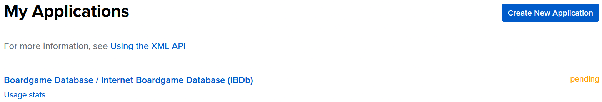

# Prosjektbeskrivelse – IT-utviklingsprosjekt (2IMI)

## Prosjekttittel

**Internet Boardgame Database (IBDb)**

---

## Bidragsytere

Sivert M. Hansen (Individuelt prosjekt)

---

## 1. Prosjektidé og problemstilling

### Beskrivelse

- Hva er prosjektet?

Prosjektet en Flask-applikasjon som jeg utvikler for å lære meg python-rammeverket og å utvikle en nettside med login og andre lignende funksjoner. Det startet som en skoleoppgave og vi har krav om blant annet å et innloggings-system på plass. Ellers vil jeg utforske funksjoner som søking, visning av database-innhold, administrering av brukere og brukerdashbord.

- Hvilket problem løser det?

Nettsiden skal la deg søke opp brettspill og finne info om dem. Dette kan man bruke som et verktøy for å researche spillet eller si noe om hvilke målgruppper spillet passer. Da slipper du å komme til spillekvelden med et spill ingen liker!

- Hvorfor er løsningen nyttig?

Nettsiden funker som et oppslagsverk for brettspill. Det betyr at du kan søke opp spill du allerede har for kanskje å hvordan det spilles om du f.eks. mistet reglene. Dersom du ikke har et spill kan du bruke nettsiden til å lese deg opp på nett isteden for å måtte dra til byen eller kjøpesenteret. Det finnes allerede en nettside som løser dette problemet, nemling Boardgamegeek. Dette er jeg ikke bekymret for, fordi dette er et læringsprosjekt, og det er bare godt med inspirasjon på hvordan en profesjonell slik nettside ser ut.

### Målgruppe

Hvem er løsningen laget for?

Løsningen er laget for de som spiller og liker brettspill, og de som vil finne ut mer om de. Det kan f.eks. være før personen velger å kjøpe det, så de kan vurdere om det er et spill for dem. Med profil kan man også bruke siden til å markere dine favorittbrettspill og få en oversikt av disse på din side.

### Forbedringer Jeg Vil Innføre

#### Et ordentlig brukerdashbord

Denne er veldig omfattende så jeg deler den opp i mindre deler:

##### Endring av egen brukerinfo

Hvis brukeren finner ut at de plutselig vil bruke en annen email, et annet brukernavn eller bytte passord, burde de kunne det. I brukerdashbordet vil jeg derfor legge til denne funksjonaliteten. Dette er relativt enkel ting som kan vise litt kompetanse innenfor Flask og SQL.

##### Gi admin og eller editor mer kraft

Til nå er den eneste forskjellen på en vanlig bruker og admin/editor muligheten til å registrere nye brettspill. I tillegg er det ingen praktiske forskjeller mellom admin og editor så langt. Jeg vil at admin skal kunne slette brukere og kunne endre informasjon som tilhører brettspillene. Da slipper jeg å gå inn i databasen for å gjøre dette manuelt. Her får jeg vise konstruksjon av en SQL-join foran eksaminator, eller lage den på forhånd for å se vise den frem og forklare hvordan den fungerer.

#### Annet

Egen side til hvert av brettspillene. Her skal blant annet beskrivelsen komme til bruk, noe den ikke egentlig har vært fra før.

##### Oversiktlige søkeresultater

Nå hentes bare alt ut av databasen og vises i en parantes, en rå python-liste. Dette er ikke optimalt. For å gjøre det enklest mulig kan jeg ta utgangspunkt i "brettspillkortene" jeg har fra før av. Jeg ser på dette som litt en backup-ting å holde på med, et ekstra gjøremål for sikkerhets skyld.

---

## 2. Teknologivalg

### Programmeringsspråk

- Python

### Rammeverk

- Flask

### Database

- MariaDB

### Andre Verktøy

- Bcrypt (kryptering)
- Boardgamegeeks XML API (søknad venter)
- BGG-API (Python wrapper for XML-APIen)
- Waitress (WSGI)
- GitHub
- GitHub Projects (Kanban)

---

## 3. Datamodell

### Programstruktur

Under ser du en oversikt av de funksjonelle delene som trengs i programmet:

```
boardgame-site/
├── app.py
├── templates/
│ ├── base.html
│ ├── index.html
│ ├── register.html
│ ├── login.html
│ ├── dashboard.html
│ ├── register_boardgame.html
│ └── results.html
├── static/
│ ├── media/
│ └── stylesheets/
│   ├── style.css
│   └── faq.css
└── .env
```

### Oversikt over tabeller

**Tabell 1:**

- Navn: user
- Beskrivelse: Innholder en brukers info om email, brukernavn og et hashet og saltet passord.

**Tabell 2:**

- Navn: boardgame
- Beskrivelse: Inneholder brettspillets navn, hvilket år det kom ut, de som lagde det, de som publiserte det og en beskrivelse.

**Tabell 3:**

- Navn: role
- Beskrivelse: Inneholder forskjellige roller som brukere kan ha. Her må jeg kjøre en manuell Insert, eller lage en funksjon i Python-filen.

**Tabell 4:**

- Navn: question
- Beskrivelse: Inneholder spørsmål om nettsiden fra brukere. Den har derfor fremmednøkkel til brukere sin ID.

**Tabell 5:**

- Navn: favorited_boardgame
- Beskrivelse: En koblingstabell (junction table) mellom *user* og *boardgame*. Brukes til favoritt-funksjonen som lar bruker se sine favorittbrettspill på brukersiden sin.

### Tabellstruktur i Databasen

Videre ser du strukturen på kommandoene brukt til å skape tabellene. Hvis du vil ha en mer grafisk fremstilling av tabellene, kan du sjekke ut [_tabellstruktur.md_](./dokumentasjon/tabellstruktur.md) som du finner i dokumentasjonsmappen.

```sql
-- Rolletabell (nr. 3)
CREATE TABLE role (
    id INT AUTO_INCREMENT PRIMARY KEY,
    name VARCHAR(20)
);
-- Innhold til rolletabell
INSERT INTO role (name) VALUES ("admin"), ("editor"), ("user");

-- Rolletabellens innhold ser dermed slik ut:
+----+--------+
| id | name   |
+----+--------+
|  1 | admin  |
|  2 | editor |
|  3 | user   |
+----+--------+

-- Brukertabell (nr. 1)
CREATE TABLE `user` (
    id INT AUTO_INCREMENT PRIMARY KEY,
    username VARCHAR(255) NOT NULL UNIQUE,
    email VARCHAR(255) NOT NULL UNIQUE,
    password CHAR(60) NOT NULL,
    role_id INT, FOREIGN KEY (role_id) REFERENCES role(id) DEFAULT 3,
    active INT
);

-- Brettspilltabell (nr. 2)
CREATE TABLE boardgame (
    id INT AUTO_INCREMENT PRIMARY KEY,
    name VARCHAR(255) NOT NULL,
    year_published INT,
    creator VARCHAR(255),
    publisher VARCHAR(255),
    img_filename VARCHAR(255),
    description TEXT CHARACTER SET utf8mb4
    );

-- Spørsmålstabell (nr. 4)
CREATE TABLE question (
    id INT AUTO_INCREMENT PRIMARY KEY,
    question TEXT NOT NULL,
    created_on TIMESTAMP DEFAULT CURRENT_TIMESTAMP,
    user_id INT NOT NULL,
    FOREIGN KEY (user_id) REFERENCES `user`(id)
);

-- Koblingstabell for favorittbrettspill (nr. 5)
CREATE TABLE favorited_boardgame (
  id INT AUTO_INCREMENT PRIMARY KEY NOT NULL, 
  user_id INT NOT NULL, 
  boardgame_id INT NOT NULL, 
  FOREIGN KEY (user_id) REFERENCES user(id), 
  FOREIGN KEY (boardgame_id) REFERENCES boardgame(id)
);

```

---

## 4. Forklaring av Kode

### Favoritt-brettspill

Denne funksjonaliteten består kode i "app.py" og i template "base.html". 
I Python-filen er det to steder med kode for dette. Den første finner du i en egen Flask-route basert rundt parameter brettspill-ID. 
Den andre finnes i index. Der hentes favorite_ids (ID for brukers favorittbrettspill) og sendes videre til template for index. Dette settet med IDer brukes til å sjekke om brettspillet skal ha en fylt eller tom hjerteknapp. En fylt knapp viser at den i favorittene dine, mens en tom en viser det omvendte.

```python
# Fra index.html (delen med favorittknapp)
                
                    <form action="/favorite/{{ i[4] }}" method="POST">
                    
                    <!-- Favorittbrettspill-knapp "avlsått" -->
                        <button type="submit">&#9829;</button>
                    
                    <!-- Favorittbrettspill-knapp "påslått" -->
                        <button type="submit">&#9825;</button>
                    
                    </form>
                
```

Her er altså "i[4]" brettspillets ID. Vi ser også at knappen bare vises om man er innlogget.

### Boardgamegeek API

Jeg vil bruke Boardgamegeeks API, men søknaden min om tilgang har ikke gått igjennom enda. Denne APIen sammen med BGG-API hadde gjort at jeg kunne hatt mange flere brettspill uten stor jobb.
BGG-API er en python API wrapper for Boardgamegeeks XML API 2. Jeg er ikke kjent med å bruke APIer generelt, og definitivt ikke via XML. Derfor velger jeg å bruke dette verktøyet som ikke bare gjør det enklere å hente ut brettspillinformasjon, men som også gjør at jeg kan bruke objekter i python, et konsept og kodespråk jeg er bedre kjent med.
Dette er dokumentasjonen til BGG-API: https://bgg-api.readthedocs.io/en/latest/


*Bilde: Jeg venter på at søknaden min for BGG XML API 2 skal bli godkjent*

---

## 5. Hvordan sette opp dette systemet

1. Før du starter må du ha installert disse på systemet (dependencies). Kjør kommandoene om du ikke har disse pakkene installert:

- git
- python

Linux:
```bash
sudo apt install python git
```

Windows:
```pwsh
# Denne kommandoen viser deg alle python-pakkene
winget search Python.Python
# Finn den nyeste pakken med og installer den slik. Denne kommandoen installerer både Python (3.14) og Git:
winget install -e --id Python.Python.3.14 Git.Git
```

2. Deretter kan du starte ved å klone prosjektet:

```bash
git clone https://github.com/sivertmh/flaskapp-boardgamedb
```

Så må du installere nødvendige pakker for appen (Det er lurt å gjøre dette i et **venv** i Python).

3. Hvis du vil opprette et venv:

```bash
# Om du ikke har et venv fra før
python -m venv .venv
```

4. Så last ned pakkene i ved hjelp av requirements-filen:

```bash
pip install -r requirements.txt
```

5. For å få kobling til database, må du overføre dotenv-filen manuelt, siden den ikke ligger på Github (legg merke til at jeg er i samme mappe som .env):

```bash
sudo scp .env [user]@[host]:[sti_til_destinasjon]
```

Eksempel:

```bash
sudo scp .env sivert@sspi3.local:/srv/myapp
```

6. Nå kan du kjøre prosjektet lokalt med Flask fra terminalen (dette er hovedsakelig for videre utvikling av appen):

```bash
python -m flask run
```

7. Du kan også kjøre med Waitress for et mer ordentlig deployment. Da kan den nås av andre på ditt LAN:

```bash
# 0.0.0.0 gjør den tilgjengelig utover LAN-et med ip-adressen til systemet den kjøres på (kjøres da på port 8080)
waitress-serve --host 0.0.0.0 app:app

# Eller, mer eksplisitt (om ønskelig kan 8080 byttes ut med en annen port):
waitress-serve --listen 0.0.0.0:8080 app:app
```

Utenom server/database, er dette alt du trenger for grunnleggende bruk/test av Flask-appen. Uten kobling til database vises ikke brettspill og login vil ikke fungere. Endre databasekoblingen til en database du har tilgang til (en ny tom database), så vil du kunne kjøre _app.py_ og tabeller vil opprettes.

8. Med tilgang på database-filen kan du kjøre denne kommandoen for å importere databasen til Mariadb (Windows):

```pwsh
Get-Content "[databasefil]" | mariadb -u [brukernavn] -p [database]
```

Tilsvarende på Linux vil være mye enklere:

```bash
mariadb -u [brukernavn] -p [database] < [databasefil]
```

Om denne metoden svikter, er det også mulig å logge inn i databasen, lime inn koden fra SQL-filen, så kjøre den.

---

**Kilder:**

Du finner kilder i dokumentet [_klideliste.md_](./dokumentasjon/kildeliste.md) som er i mappen _dokumentasjon_. Det står vanligvis kommentert i koden der jeg har brukt en kilde.
